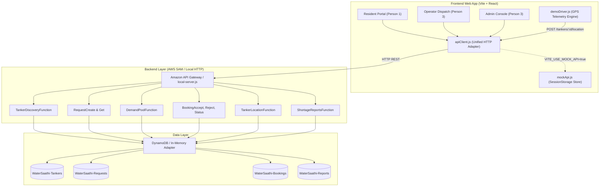

# WaterSaathi — System Architecture & Integration Guide

## 1. Architectural Vision

**WaterSaathi (जलसाथी)** is an accessible community water platform designed for semi-arid and urban Indian localities facing irregular municipal water distribution. Its primary operational hub for demonstration is **Chhatrapati Sambhajinagar (Aurangabad), Maharashtra**.

Rather than functioning as a passive tanker directory, WaterSaathi operates an active matching and demand-coordination engine:
1. **Nearby Tanker Discovery:** Locates verified tankers with explicit capacity, pricing, and telemetry freshness.
2. **Community Demand Pooling:** Coordinates separate household requests in close proximity into combined tanker trips to reduce transit deadhead.
3. **Operator Dispatch & Lifecycle Management:** Real-time queue management for tanker drivers to accept, update trip progress (`EN_ROUTE`), and confirm delivery.
4. **Hardware-Agnostic GPS Telemetry:** A simulated driver that emits realistic GPS coordinates along actual municipal roads, built on a contract that can be swapped for hardware OBD/GPS units without modifying the core booking engine.
5. **Administrative Transparency & Shortage Auditing:** Flags stale locations (> 4h) and anomalous rates (< ₹150 or > ₹2,000/1000L), and enables review of citizen-submitted shortage alerts.

---

## 2. Team Division of Responsibilities

```
                         ┌─────────────────────────────────────────────────────────────┐
                         │                        WATERSAATHI                          │
                         └──────────────────────────────┬──────────────────────────────┘
                                                        │
         ┌──────────────────────────────────────────────┼──────────────────────────────────────────────┐
         ▼                                              ▼                                              ▼
┌─────────────────────────────────┐    ┌─────────────────────────────────┐    ┌─────────────────────────────────┐
│            PERSON 1             │    │            PERSON 2             │    │            PERSON 3             │
│       Resident Experience       │    │     Serverless API & Data       │    │   Operator, Admin & Testing     │
├─────────────────────────────────┤    ├─────────────────────────────────┤    ├─────────────────────────────────┤
│ • ResidentPage.jsx              │    │ • AWS SAM template.yaml         │    │ • OperatorPage.jsx              │
│ • Tanker discovery Leaflet map  │    │ • Lambda handlers (Node.js)     │    │ • AdminPage.jsx                 │
│ • Water request submission      │    │ • DynamoDB tables & queries     │    │ • Demo GPS Driver (demoDriver)  │
│ • Demand pooling acceptance     │    │ • Candidate matching engine     │    │ • Operator booking controls     │
│ • Order progress tracking       │    │ • Transparent pricing engine    │    │ • Shortage report audit actions │
│ • Locality & Geolocation picker │    │ • Concurrency conditional write │    │ • Automated E2E test suite      │
│ • apps/web/src/styles/resident  │    │ • backend/src/ & backend/tests/ │    │ • docs/TEST_PLAN.md             │
└─────────────────────────────────┘    └─────────────────────────────────┘    └─────────────────────────────────┘
```

---

## 3. Component Architecture & Data Flow



---

## 4. Key Architectural Patterns

### 4.1 Demand Pooling Coordination
Pooling pairs multiple compatible orders without merging them into an anonymous lump sum.
- **Participant Integrity:** Each household retains its individual order record (`requestId`), individual volume allocation (e.g. 1,000L), and quoted price share.
- **Matching Constraints:** Max distance &le; 7.5 km, delivery window difference &le; 120 minutes, tanker available capacity &ge; combined sum, and matching water category.
- **Honesty in Communication:** The system does not claim guaranteed savings or emission reductions unless mathematically confirmed by distance and shared tanker capacity.

### 4.2 Swappable GPS Telemetry
`demoDriver.js` emits position telemetry events adhering to standard vehicle tracking specs:
```javascript
{
  latitude: 19.8762,
  longitude: 75.3433,
  speedKmph: 28,
  headingDeg: 72,
  locationSource: "SIMULATED",
  timestamp: "2026-10-11T08:35:00.000Z"
}
```
This telemetry is sent to `POST /tankers/{id}/location`. When real hardware GPS or mobile HTML5 geolocation is connected in production, only the coordinate producer changes; no changes are required to the database schema or booking state machine.

### 4.3 Concurrent Capacity Allocation Protection
To avoid the classic double-booking concurrency flaw where two concurrent requests read capacity and both write, backend updates utilize conditional writes:
```javascript
ConditionExpression: "attribute_exists(tankerId) AND availableLitres >= :requiredLitres AND #status IN (:available, :busy)"
```
If a conflicting transaction modifies capacity between read and write, DynamoDB raises `ConditionalCheckFailedException` and the API returns HTTP 409 Conflict.

---

## 5. Security & Truthfulness Principles

1. **Simulated Telemetry Transparency:** All simulated coordinates are explicitly flagged with `locationSource: "SIMULATED"`. The UI never represents simulated waypoints as live physical GPS.
2. **Freshness Tracking:** Any location update older than 4 hours is flagged as `STALE` in the admin console.
3. **No Unwarranted Potability Claims:** Water categories (`DRINKING` vs `NON_DRINKING`) are labeled as operator-declared utility water. The platform does not make claims of laboratory potability certification without independent lab testing.
4. **Community Reports Disclaimer:** Resident water shortage reports are explicitly labeled as community crowdsourced notices rather than official municipal municipal announcements.
# WaterSaathi — System Architecture

## Architecture Overview
WaterSaathi connects Indian residents, societies, schools, and small businesses facing water scarcity with tanker operators and community demand pooling.

```
+-----------------------------------------------------------------------------------+
|                              WaterSaathi Architecture                             |
+-----------------------------------------------------------------------------------+
|  [Person 1: Resident Web]         [Person 3: Operator Web]    [Person 3: Admin Web]|
|  - Leaflet Map (OSM tiles)        - Trip Queue                - Tanker Fleet       |
|  - Tanker Discovery               - Accept/Reject             - Verification Badge |
|  - Water Request Booking          - Status Transitions        - Shortage Reports   |
|  - Demand Pooling Flow            - GPS Simulation (Demo)     - Price Oversight    |
|  - Real-time Timeline Tracker     - Availability Toggle                            |
+-----------------------------------------------------------------------------------+
                                        | (REST JSON)
                                        v
+-----------------------------------------------------------------------------------+
|                     [Person 2: Backend API Gateway & Lambdas]                      |
|  - GET /tankers                 - POST /bookings/{id}/accept                      |
|  - POST /requests               - POST /bookings/{id}/status                      |
|  - GET /requests/{id}           - POST /tankers/{id}/location                     |
|  - POST /requests/{id}/pool     - POST /shortage-reports                          |
|  - GET /bookings                - GET /admin/shortage-reports                     |
+-----------------------------------------------------------------------------------+
                                        |
                 +----------------------+----------------------+
                 | (Local Dev / CI)                            | (AWS Production)
                 v                                             v
+--------------------------------+            +---------------------------------+
| In-Memory Store & Test Runner  |            | Amazon DynamoDB Tables          |
| - Fast offline test coverage   |            | - WaterSaathi-Tankers           |
| - Zero external dependencies   |            | - WaterSaathi-Requests          |
|                                |            | - WaterSaathi-Bookings          |
|                                |            | - WaterSaathi-Reports           |
+--------------------------------+            +---------------------------------+
```

## Domain Model
- **Tanker:** Registered water supplier with capacity, rate, verification flag, water type, status, and latest coordinates.
- **Request:** Resident water order with location, quantity, delivery window, and quoted price.
- **Demand Pool:** Proximity and delivery-window matching algorithm that groups compatible neighborhood requests to share a tanker trip.
- **Booking:** Confirmed delivery contract tying one or more requests to a specific tanker.
- **Shortage Report:** Community-submitted crowd-sourced signal of water scarcity in a locality.

## Development & Deployment
- Frontend: React + Vite + standard CSS + Leaflet (hosted on AWS Amplify).
- Backend: AWS SAM, Node.js Lambda runtime, DynamoDB.
