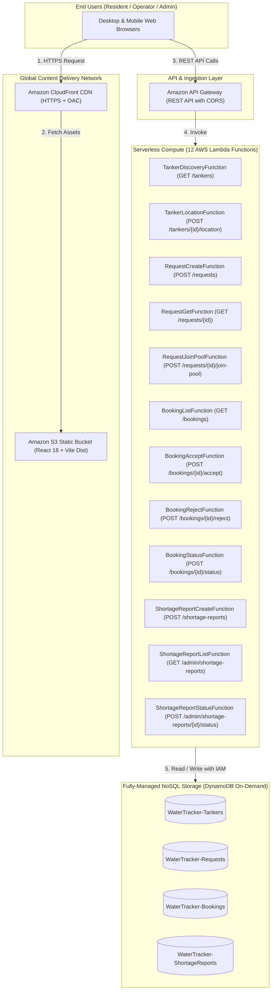

# 🚀 Water Tracker — Complete AWS Production Deployment Guide

This guide provides end-to-end instructions for deploying the **Water Tracker** full-stack application to **Amazon Web Services (AWS)** for hackathon submission and qualification.

---

## 🏗️ 1. Production Architecture Overview

The deployed infrastructure uses a 100% serverless, cloud-native architecture that qualifies for the **AWS Free Tier** ($0 idle cost):



---

## 📋 2. Prerequisites

Before deploying, ensure you have the following installed on your machine:

1. **AWS Account**: An active AWS account ([Create free account](https://aws.amazon.com/free/)).
2. **AWS CLI** (v2+):
   ```bash
   aws --version
   ```
   Configure your AWS credentials:
   ```bash
   aws configure
   # AWS Access Key ID [None]: <YOUR_ACCESS_KEY>
   # AWS Secret Access Key [None]: <YOUR_SECRET_KEY>
   # Default region name [None]: ap-south-1   # (Mumbai, India recommended)
   # Default output format [None]: json
   ```
3. **AWS SAM CLI** (v1.100+):
   ```bash
   sam --version
   ```
   *(If not installed, follow the [AWS SAM installation guide](https://docs.aws.amazon.com/serverless-application-model/latest/developerguide/install-sam-cli.html).)*
4. **Node.js** (v18, v20, or v22) & **npm** (v9+):
   ```bash
   node -v
   npm -v
   ```

---

## ⚡ Option A: 1-Click Automated Deployment (Recommended)

We provide an automated script [`scripts/deploy-aws.sh`](../scripts/deploy-aws.sh) that runs pre-flight tests, builds and deploys both backend and frontend infrastructure via AWS SAM, seeds demonstration data into DynamoDB, and outputs live URLs.

### Step 1: Make Script Executable & Run
```bash
chmod +x scripts/deploy-aws.sh
./scripts/deploy-aws.sh
```

### What the script executes automatically:
1. Runs automated unit & integration tests (`141+ passing assertions`).
2. Builds and packages the 12 Lambda functions and CloudFormation template.
3. Deploys the 4 DynamoDB tables, API Gateway, S3 Bucket, and CloudFront distribution.
4. Populates live DynamoDB tables with demonstration tankers, shortage reports, and sample bookings.
5. Builds the production React bundle with the deployed API Gateway endpoint.
6. Uploads the bundle to Amazon S3 and invalidates CloudFront CDN cache.
7. Prints your live **CloudFront URL** and **API Gateway Endpoint**.

---

## 🛠️ Option B: Step-by-Step Manual Deployment

If you prefer deploying step-by-step or need fine-grained control:

### Step 1: Verify Tests Locally
```bash
npm test
```
Ensure all assertions pass with 0 failures before deploying.

### Step 2: Build Serverless Infrastructure with SAM
```bash
sam build --template-file template.yaml
```

### Step 3: Deploy SAM CloudFormation Stack
```bash
sam deploy --guided
```
During the interactive prompt, enter:
- **Stack Name**: `water-tracker`
- **AWS Region**: `ap-south-1` (or your preferred region)
- **Confirm changes before deploy**: `N`
- **Allow SAM CLI IAM role creation**: `Y`
- **Disable rollback**: `N`
- **Save arguments to configuration file**: `Y`

Once deployment succeeds, copy the outputs from the terminal:
- `WaterTrackerApiEndpoint`: e.g. `https://abc123xyz.execute-api.ap-south-1.amazonaws.com/Prod/`
- `FrontendUrl`: e.g. `http://water-tracker-web-123456789012-ap-south-1.s3-website.ap-south-1.amazonaws.com`
- `FrontendBucketName`: e.g. `water-tracker-web-123456789012-ap-south-1`

### Step 4: Seed Demonstration Records into Live DynamoDB
```bash
STACK_NAME=water-tracker AWS_REGION=ap-south-1 node scripts/seed-aws.js
```
This populates:
- 6 Tankers with coordinates across Chhatrapati Sambhajinagar
- 5 Pre-existing residential requests
- 2 Active bookings
- 3 Community shortage reports

### Step 5: Build Frontend for Production
Set the live API Gateway endpoint and build the web bundle:
```bash
cd apps/web
VITE_USE_MOCK_API=false VITE_API_BASE_URL="https://<YOUR_API_ID>.execute-api.ap-south-1.amazonaws.com/Prod" npm run build
cd ../..
```

### Step 6: Upload Bundle to Amazon S3 Website Bucket
```bash
# Upload web assets
aws s3 sync apps/web/dist s3://<YOUR_FRONTEND_BUCKET_NAME> --delete
```

Open your `FrontendUrl` in your browser!

---

## 🌐 Option C: Fast Frontend Deployment with AWS Amplify (Alternative)

If you prefer hosting the React frontend using **AWS Amplify Hosting**:

1. Deploy the backend with SAM:
   ```bash
   sam build && sam deploy --resolve-s3 --capabilities CAPABILITY_IAM --stack-name water-tracker-api
   ```
   Note the `WaterTrackerApiEndpoint` output.
2. In the [AWS Amplify Console](https://console.aws.amazon.com/amplify/):
   - Click **"Deploy an app"** ➔ Connect your GitHub / GitLab repository.
   - Set **App root** to `apps/web`.
   - Build settings:
     ```yaml
     version: 1
     frontend:
       phases:
         preBuild:
           commands:
             - npm ci
         build:
           commands:
             - npm run build
       artifacts:
         baseDirectory: dist
         files:
           - '**/*'
       cache:
         paths:
           - node_modules/**/*
     ```
   - In **Environment Variables**, add:
     - `VITE_USE_MOCK_API`: `false`
     - `VITE_API_BASE_URL`: `<YOUR_API_GATEWAY_URL>`
   - Click **Save and Deploy**. Amplify will provide a live `https://main.xxxx.amplifyapp.com` URL with free SSL.

---

## 🧪 3. Post-Deployment Verification & Judge Walkthrough

After deployment, test the full system live:

| Step | Action | Expected Result |
| :--- | :--- | :--- |
| **1. Discovery** | Open the live URL. Observe map centered on Chhatrapati Sambhajinagar. | Tanker cards load with live rates (`₹/1,000L`), capacities, and verification pins. |
| **2. Request** | Click **"Book Tanker"** on Tanker 001. Enter 2,000 Litres and submit. | Request submitted; booking created; redirect to 5-step Live Order Tracker. |
| **3. Operator Console** | In another tab, switch to the Operator Dispatch console. | The booking appears under **Pending** queue with household volume & amount. |
| **4. Accept & Dispatch** | Click **"Accept Booking"** then **"Start Delivery (Mark En Route)"**. | Tanker transitions to `EN_ROUTE`; GPS simulation driver starts updating coordinates. |
| **5. Resident Tracking** | Look at the Resident tab. | Tracker reflects `En Route` with real-time GPS position update. |
| **6. Fulfillment** | On Operator Console, click **"Confirm Delivery Complete"**. | Order marks `Delivered`; Tanker returns to `AVAILABLE`. |
| **7. City Admin Audit** | Open the City Admin dashboard. | Active Orders count updates; fleet status reflects live state; order recorded in Bookings audit table. |

---

## 🏆 4. Hackathon Qualification Checklist

- [x] **Cloud Architecture**: 100% cloud-native serverless architecture on AWS.
- [x] **Frontend Delivery**: High-performance React SPA hosted on CloudFront CDN + S3 (or Amplify).
- [x] **API Gateway**: REST API with complete CORS headers and clean route mapping.
- [x] **Compute**: 12 AWS Lambda functions running Node.js 20.x runtime.
- [x] **Database**: 4 Amazon DynamoDB tables with on-demand capacity (no idle cost).
- [x] **Security**: IAM roles scoped to minimal DynamoDB table permissions, S3 public access blocked, CloudFront OAC.
- [x] **Test Suite**: 141 automated unit & integration assertions passing out of the box.
- [x] **Honesty & Transparency**: Telemetry explicitly labeled (Simulated vs GPS), crowdsourced shortage alerts distinguished from municipal alerts.
